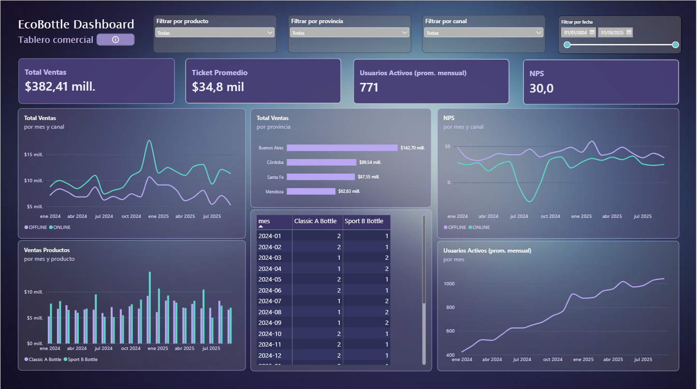

# EcoBottle AR — Mini ecosistema de datos comercial

Trabajo práctico de **Introducción al Marketing Online y los Negocios Digitales**
(Licenciatura en Ciencia de Datos — Universidad Austral).

**Autor:** Mateo Andrés López Valci

A partir de una foto del sistema de ventas de EcoBottle AR (13 tablas en `raw/`,
pedidos del 01/01/2024 al 30/09/2025) construimos un **data warehouse con modelo
estrella (Kimball)** en DuckDB y un **tablero comercial en Power BI** con los KPIs
que monitorea el management: Ventas, Ticket Promedio, Usuarios Activos, NPS,
Ventas por Provincia y Ranking mensual por Producto.



---

## Índice

1. [Arquitectura](#arquitectura)
2. [Estructura del repositorio](#estructura-del-repositorio)
3. [Cómo ejecutarlo](#cómo-ejecutarlo)
4. [Modelo de datos](#modelo-de-datos)
5. [Diccionario de datos](#diccionario-de-datos)
6. [Supuestos y decisiones de diseño](#supuestos-y-decisiones-de-diseño)
7. [Validación del modelo](#validación-del-modelo)
8. [KPIs y consultas clave](#kpis-y-consultas-clave)
9. [Dashboard](#dashboard)
10. [Hallazgos](#hallazgos)
11. [Limitaciones y próximos pasos](#limitaciones-y-próximos-pasos)

---

## Arquitectura

```
raw/ (13 CSV, OLTP normalizado)
   │   ETL en SQL (DuckDB) — sql/*.sql, orquestado por run_sql.py
   ▼
Data warehouse (warehouse.duckdb)
   ├── 10 dimensiones  dim_date, dim_customer, dim_channel, dim_store, dim_address, dim_product,
   │                   dim_order_status, dim_payment, dim_shipment_status, dim_traffic
   ├── 4 hechos        fact_sales_order, fact_sales_order_item, fact_web_session, fact_nps_response
   └── 4 marts         mart_ventas, mart_productos, mart_usuarios, mart_nps  (+ 4 tablas filtro_*)
   │   exportado a CSV
   ▼
dw/*.csv  ──►  Power BI (dashboard/ecobottle.pbix)
```

Principios que seguimos:

- **raw solo lo lee el ETL.** Todas las consultas de KPIs y el tablero leen
  exclusivamente tablas del data warehouse (`dim_`, `fact_`, `mart_`).
- **Los cálculos se hacen en el ETL, no en la visualización.** Los marts llegan a
  Power BI ya agregados por mes y con los nombres de las dimensiones resueltos.
  Power BI solo suma y hace la división final de los KPIs que son cocientes
  (ver [Marts](#marts-capa-de-presentación)).

> **Nota sobre la consigna:** la consigna original propone transformaciones en
> Python y tablero en LookerStudio. Siguiendo las indicaciones del repositorio de
> la práctica, implementamos el ETL en **SQL sobre DuckDB** y el tablero en
> **Power BI**.

---

## Estructura del repositorio

```
raw/                     Datos de origen (no se modifican)
sql/
  01_dimensiones.sql     dim_product (ejemplo provisto por la cátedra)
  01b_dimensiones.sql    Dimensiones principales (fecha, cliente, canal, tienda, dirección)
  01c_dimensiones_atributos.sql  Dimensiones de atributos (estados, pago, tráfico)
  02_hechos.sql          Plantilla de la cátedra (sin sentencias)
  02a..02d_fact_*.sql    Las 4 tablas de hechos
  03_consultas.sql       Validaciones del modelo y KPIs
  04_marts.sql           Marts y tablas de filtro para el tablero
dw/                      Data warehouse exportado a CSV + diagrama del modelo
dashboard/
  ecobottle.pbix         Tablero de Power BI
  ecobottle_tema.json    Tema visual del tablero
  tablero.png            Captura del tablero
run_sql.py               Ejecuta los SQL en orden y exporta dw/
requirements.txt         Dependencias (DuckDB)
```

Los archivos de `sql/` se ejecutan en **orden alfabético**: las dimensiones antes que
los hechos (porque los hechos tienen `FOREIGN KEY` hacia ellas) y los marts al final.

---

## Cómo ejecutarlo

Requisitos: Python 3.9+ y Git.

```bash
git clone https://github.com/ifylopez/practica-imond.git
cd practica-imond
python -m venv .venv

# Windows
.venv\Scripts\activate
# Mac / Linux
source .venv/bin/activate

pip install -r requirements.txt
python run_sql.py
```

`run_sql.py` crea `warehouse.duckdb` desde cero, ejecuta los SQL en orden, muestra
en consola el resultado de las validaciones y KPIs, y exporta todas las tablas a
`dw/` junto con el diagrama `dw/modelo_estrella.md`.

Otros modos:

- `python run_sql.py --explorar` — abre DuckDB con las tablas `raw` para explorar.
- `python run_sql.py --ui` — arma el DW y lo abre en DuckDB.

**Tablero:** abrir `dashboard/ecobottle.pbix` con Power BI Desktop. Si se volvió a
correr `run_sql.py`, usar **Inicio → Actualizar** para recargar los CSV de `dw/`.
Al importar CSV en Power BI con configuración regional en español, la configuración
regional de importación del archivo debe estar en *Inglés (Estados Unidos)*: los CSV
usan punto decimal.

---

## Modelo de datos

Esquema estrella según Kimball: **4 tablas de hechos** y **10 dimensiones**.
Las 6 principales (fecha, cliente, canal, tienda, dirección, producto) son
**dimensiones conformadas**: las comparten varios hechos con el mismo significado.
Las 4 de atributos (estado del pedido, pago, estado del envío, tráfico) sacan de los
hechos los atributos descriptivos que antes quedaban como texto suelto. El diagrama completo se genera en
[`dw/modelo_estrella.md`](dw/modelo_estrella.md).

En el diagrama, las tablas `mart_*` y `filtro_*` aparecen sin relaciones: son la capa de presentación, derivada de los hechos con `CREATE TABLE ... AS SELECT`, y sus relaciones se definen en Power BI.

### Granos

| Hecho | Grano: una fila representa… | Tipo |
|---|---|---|
| `fact_sales_order` | un **pedido** realizado por un cliente, en un canal, en una fecha | *Accumulating snapshot*: integra pago y envío del pedido |
| `fact_sales_order_item` | una **línea de pedido** (un producto dentro de un pedido), en la fecha del pedido | Transaccional |
| `fact_web_session` | una **sesión de navegación** de un visitante (identificado o anónimo) que empieza en un momento | *Factless*: se analiza contando filas |
| `fact_nps_response` | una **respuesta a la encuesta NPS** de un cliente (o anónima), en un canal, en una fecha | Transaccional |

### Por qué dos hechos de ventas

`sales_order` (cabecera) y `sales_order_item` (líneas) tienen relación **1 a N**.
Unirlas en un solo hecho a nivel línea repetiría los montos de cabecera
(`total_amount`, `shipping_fee`, `tax_amount`) en cada línea y **duplicaría las
ventas** al sumar. Por eso cada una es un hecho con su propio grano:

- Ventas, Ticket y Ventas por Provincia salen de `fact_sales_order`.
- El Ranking por Producto sale de `fact_sales_order_item`, que es el único que
  conoce el producto.

### Por qué pago y envío están dentro del hecho de pedido

Verificamos las cardinalidades: cada pedido tiene **exactamente 1 pago** y
**0 o 1 envío** (las compras en tienda no tienen envío). Como ninguna de las dos
supera 1, integrarlas no cambia el grano. Se unen con `LEFT JOIN` para no perder
los pedidos sin envío. La validación V1 confirma que no se perdieron ni duplicaron
filas.

### Matriz de dimensiones

| Hecho | Fecha | Cliente | Canal | Tienda | Dirección/Provincia | Producto | Estado pedido | Pago | Estado envío | Tráfico |
|---|:-:|:-:|:-:|:-:|:-:|:-:|:-:|:-:|:-:|:-:|
| `fact_sales_order` | ✓ | ✓ | ✓ | ✓ | ✓ | — | ✓ | ✓ | ✓ | — |
| `fact_sales_order_item` | ✓ | ✓ | ✓ | — | ✓ | ✓ | — | — | — | — |
| `fact_web_session` | ✓ | ✓ | — | — | — | — | — | — | — | ✓ |
| `fact_nps_response` | ✓ | ✓ | ✓ | — | — | — | — | — | — | — |

---

## Diccionario de datos

### Convenciones

- **`<x>_key`**: clave **subrogada** propia del DW (generada con `ROW_NUMBER()`).
  Es la `PRIMARY KEY` de cada dimensión y la que usan los hechos como `FOREIGN KEY`.
- **`<x>_id`**: clave **natural** del sistema de origen. Se conserva en la dimensión
  para traducirla a la clave subrogada al cargar los hechos.
- **Miembro `-1` "Desconocido"**: fila especial en las dimensiones que lo necesitan.
  Los hechos sin dato (cliente anónimo, pedido online sin tienda) apuntan a `-1`,
  así **ninguna FK queda en NULL**.
- **`date_key`**: clave numérica `AAAAMMDD` (ej. `20240131`), práctica estándar de
  Kimball para la dimensión fecha.
- Montos en **pesos argentinos (ARS)**, `DECIMAL(12,2)`.

### Dimensiones

**`dim_date`** — calendario, un día por fila (2023-01-01 a 2026-12-31)

| Columna | Tipo | Descripción |
|---|---|---|
| `date_key` | INTEGER **PK** | Fecha como `AAAAMMDD` |
| `date` | DATE | Fecha |
| `year`, `quarter`, `month`, `day` | INTEGER | Partes de la fecha |
| `month_name` | VARCHAR | Nombre del mes |
| `year_month` | VARCHAR | `AAAA-MM` |
| `weekday_num` | INTEGER | 1 = lunes … 7 = domingo |
| `weekday_name` | VARCHAR | Nombre del día |
| `is_weekend` | BOOLEAN | Sábado o domingo |

**`dim_customer`** — clientes

| Columna | Tipo | Descripción |
|---|---|---|
| `customer_key` | INTEGER **PK** | Clave subrogada. **`-1` = Anónimo** |
| `customer_id` | INTEGER | Clave natural (NULL en `-1`) |
| `first_name`, `last_name`, `full_name` | VARCHAR | Nombre |
| `status` | VARCHAR | Dominio: `A` (activo), `I` (dio de baja su cuenta) |
| `status_desc` | VARCHAR | `Activo` / `Inactivo` / `Anónimo` |
| `created_date` | DATE | Fecha de alta |
| `cohort_month` | VARCHAR | Mes de alta (`AAAA-MM`), para análisis de cohortes |

> **Datos personales:** `email` y `phone` **no se cargan** en el DW porque ningún
> análisis los necesita (minimización de datos personales).

**`dim_channel`** — canales de venta

| Columna | Tipo | Descripción |
|---|---|---|
| `channel_key` | INTEGER **PK** | Clave subrogada |
| `channel_id` | INTEGER | Clave natural |
| `code` | VARCHAR | Dominio: `ONLINE`, `OFFLINE` |
| `name` | VARCHAR | Nombre descriptivo |

**`dim_store`** — tiendas físicas

| Columna | Tipo | Descripción |
|---|---|---|
| `store_key` | INTEGER **PK** | Clave subrogada. **`-1` = Sin tienda (online)** |
| `store_id` | INTEGER | Clave natural |
| `name` | VARCHAR | Nombre de la tienda |
| `city`, `province` | VARCHAR | Ubicación (aplanada desde `address` y `province`) |

**`dim_address`** — direcciones con la geografía aplanada

| Columna | Tipo | Descripción |
|---|---|---|
| `address_key` | INTEGER **PK** | Clave subrogada. **`-1` = Desconocida** |
| `address_id` | INTEGER | Clave natural |
| `city` | VARCHAR | Ciudad |
| `province` | VARCHAR | Dominio: Buenos Aires, Córdoba, Santa Fe, Mendoza |
| `province_code` | VARCHAR | Código de provincia |
| `postal_code`, `country_code` | VARCHAR | Código postal, país (`AR`) |
| `is_store` | BOOLEAN | TRUE si es la dirección de una tienda |

**`dim_product`** — productos (provista por la cátedra)

| Columna | Tipo | Descripción |
|---|---|---|
| `product_key` | INTEGER **PK** | Clave subrogada |
| `product_id` | INTEGER | Clave natural |
| `sku`, `name` | VARCHAR | Identificación (Classic A Bottle, Sport B Bottle) |
| `category` | VARCHAR | Classic / Sport |
| `family` | VARCHAR | Bottles (categoría padre, aplanada) |
| `list_price` | DECIMAL | Precio de lista sin IVA |

**`dim_order_status`** — estado del pedido

| Columna | Tipo | Descripción |
|---|---|---|
| `order_status_key` | INTEGER **PK** | Clave |
| `status` | VARCHAR | Dominio: `CREATED`, `PAID`, `FULFILLED`, `CANCELLED`, `REFUNDED` |
| `status_desc` | VARCHAR | Descripción en español |
| `is_sale` | BOOLEAN | TRUE para `PAID` y `FULFILLED` (cuentan como venta) |
| `sort_order` | INTEGER | Orden en el ciclo de vida, para el embudo |

Se carga con el dominio fijo de la consigna (`VALUES`), así existen los 5 estados
aunque alguno no tenga pedidos.

**`dim_payment`** — medio y estado del pago (*junk dimension*)

| Columna | Tipo | Descripción |
|---|---|---|
| `payment_key` | INTEGER **PK** | Clave subrogada. **`-1` = Sin pago** |
| `method` | VARCHAR | Dominio: `CASH`, `CARD`, `TRANSFER`, `GATEWAY` |
| `method_desc` | VARCHAR | Efectivo / Tarjeta / Transferencia / Pasarela de pago |
| `payment_status` | VARCHAR | Dominio: `PENDING`, `PAID`, `FAILED`, `REFUNDED` |
| `status_desc` | VARCHAR | Pendiente / Pagado / Rechazado / Reembolsado |

**`dim_shipment_status`** — estado del envío

| Columna | Tipo | Descripción |
|---|---|---|
| `shipment_status_key` | INTEGER **PK** | Clave. **`-1` = Sin envío** (compras en tienda) |
| `status` | VARCHAR | Dominio: `READY`, `SHIPPED`, `DELIVERED`, `CANCELLED` |
| `status_desc` | VARCHAR | En preparación / En viaje / Entregado / Cancelado |

**`dim_traffic`** — fuente y dispositivo de la sesión web (*junk dimension*)

| Columna | Tipo | Descripción |
|---|---|---|
| `traffic_key` | INTEGER **PK** | Clave subrogada. **`-1` = Desconocido** |
| `source` | VARCHAR | Dominio: `ads`, `direct`, `referral`, `organic` |
| `source_desc` | VARCHAR | Publicidad en redes / Directo-newsletter / Otro sitio / Buscadores |
| `device` | VARCHAR | Dominio: `mobile`, `desktop`, `tablet` |

> **Junk dimension:** agrupa en una sola dimensión varios atributos de pocos valores
> que no justifican una dimensión cada uno. Tiene una fila por cada combinación que
> existe en los datos (ej. `ads` + `mobile`).

### Hechos

**`fact_sales_order`** — un pedido

| Columna | Tipo | Descripción |
|---|---|---|
| `order_id` | BIGINT **PK** | Dimensión degenerada (identificador del pedido) |
| `date_key` | INTEGER **FK** → `dim_date` | Fecha del pedido |
| `customer_key` | INTEGER **FK** → `dim_customer` | Cliente |
| `channel_key` | INTEGER **FK** → `dim_channel` | Canal |
| `store_key` | INTEGER **FK** → `dim_store` | Tienda (`-1` si es ONLINE) |
| `shipping_address_key` | INTEGER **FK** → `dim_address` | Dirección de envío (en tienda, la de la tienda) |
| `order_status_key` | INTEGER **FK** → `dim_order_status` | Estado del pedido |
| `payment_key` | INTEGER **FK** → `dim_payment` | Medio y estado del pago |
| `shipment_status_key` | INTEGER **FK** → `dim_shipment_status` | Estado del envío (`-1` sin envío) |
| `order_date` | TIMESTAMP | Fecha y hora del pedido |
| `is_sale` | BOOLEAN | Bandera de conveniencia: copia de `dim_order_status.is_sale` (filtro de casi todos los KPIs) |
| `subtotal`, `tax_amount`, `shipping_fee`, `total_amount` | DECIMAL | Montos (`total = subtotal + IVA 21% + envío`) |
| `paid_at` | TIMESTAMP | NULL si el pago no se concretó |
| `shipped_at`, `delivered_at` | TIMESTAMP | Fechas de despacho y entrega (hitos del ciclo de vida) |

**`fact_sales_order_item`** — una línea de pedido

| Columna | Tipo | Descripción |
|---|---|---|
| `order_item_id` | BIGINT **PK** | Identificador de la línea |
| `order_id` | BIGINT | Dimensión degenerada: une con `fact_sales_order` |
| `product_key` | INTEGER **FK** → `dim_product` | Producto |
| `date_key`, `customer_key`, `channel_key`, `shipping_address_key` | INTEGER **FK** | Contexto heredado de la cabecera |
| `is_sale` | BOOLEAN | Estado del pedido: PAID o FULFILLED |
| `quantity` | INTEGER | Unidades (> 0) |
| `unit_price`, `discount_amount` | DECIMAL | Precio unitario y descuento |
| `line_total` | DECIMAL | `quantity × unit_price − discount_amount` (sin IVA ni envío) |

**`fact_web_session`** — una sesión web

| Columna | Tipo | Descripción |
|---|---|---|
| `session_id` | BIGINT **PK** | Identificador de la sesión |
| `date_key` | INTEGER **FK** → `dim_date` | Fecha de inicio |
| `customer_key` | INTEGER **FK** → `dim_customer` | Cliente (`-1` = anónimo) |
| `traffic_key` | INTEGER **FK** → `dim_traffic` | Fuente y dispositivo |
| `started_at`, `ended_at` | TIMESTAMP | Inicio y fin (`ended_at` puede faltar) |

**`fact_nps_response`** — una respuesta NPS

| Columna | Tipo | Descripción |
|---|---|---|
| `nps_id` | BIGINT **PK** | Identificador de la respuesta |
| `date_key` | INTEGER **FK** → `dim_date` | Fecha de respuesta |
| `customer_key` | INTEGER **FK** → `dim_customer` | Cliente (`-1` = anónima) |
| `channel_key` | INTEGER **FK** → `dim_channel` | Canal |
| `responded_at` | TIMESTAMP | Fecha y hora |
| `score` | SMALLINT | 0 a 10 |
| `is_promoter` | INTEGER | 1 si `score` 9–10 |
| `is_detractor` | INTEGER | 1 si `score` 0–6 |

### Marts (capa de presentación)

| Mart | Grano | Columnas |
|---|---|---|
| `mart_ventas` | mes × canal × provincia | `pedidos`, `ventas` |
| `mart_productos` | mes × canal × provincia × producto | `unidades`, `ventas_productos` |
| `mart_usuarios` | mes | `usuarios_activos`, `sesiones`, `sesiones_anonimas` |
| `mart_nps` | mes × canal | `respuestas`, `promotores`, `detractores` |

Los marts guardan solo **medidas aditivas** (sumas y conteos). Los KPIs que son
cocientes (Ticket, NPS) se dividen en el tablero **después** de sumar: un promedio de
promedios daría mal al filtrar varios meses, canales o provincias. La excepción es
`usuarios_activos`, que es un `COUNT(DISTINCT)` (no aditivo) y por eso se calcula
terminado por mes. Las tablas `filtro_mes`, `filtro_canal`, `filtro_provincia` y
`filtro_producto` contienen los valores de cada filtro y se relacionan 1:\* con los
marts en Power BI.

---

## Supuestos y decisiones de diseño

1. **Qué cuenta como venta:** solo pedidos con `status` en `PAID` o `FULFILLED`
   (columna `is_sale`). `CREATED`, `CANCELLED` y `REFUNDED` no suman a ventas,
   ticket, provincia ni ranking.
2. **Provincia de una venta:** se toma la de la **dirección de envío**. En compras en
   tienda, la dirección de envío es la de la tienda, así que la provincia es la de la
   tienda.
3. **Usuarios activos:** `COUNT(DISTINCT customer_key)` de sesiones web por mes,
   **excluyendo el miembro `-1`** (anónimos). Si no se excluyera, todas las sesiones
   anónimas contarían como un único "usuario".
4. **Ranking por producto:** por facturación de productos (`line_total`, sin IVA ni
   envío), filtrando `is_sale` para ser consistente con Ventas. Por eso la suma del
   ranking **no coincide** con Total Ventas (que incluye IVA y envío): es esperado.
5. **NPS:** `(promotores − detractores) × 100 / respuestas`, incluyendo las
   respuestas anónimas (son opiniones válidas).
6. **Dimensión fecha** con rango 2023–2026, más amplio que los datos, para que
   cualquier fecha futura tenga su `date_key`.
7. **Canal sin miembro `-1`:** todo pedido y toda respuesta NPS tienen canal. Si en
   el futuro faltara uno, preferimos que la carga falle (FK) a ocultarlo.

---

## Validación del modelo

Consultas en `sql/03_consultas.sql`, ejecutadas en cada corrida de `run_sql.py`.

| # | Control | Resultado |
|---|---|---|
| V1 | Filas en raw vs DW (pedidos / líneas / sesiones / NPS) | 11.969 / 14.573 / 100.363 / 3.083 en ambos: **no se perdieron ni duplicaron filas** |
| V2 | La suma de `line_total` de cada pedido = su `subtotal` | **0** pedidos que no cierran |
| V3 | Pedidos sin ninguna línea | **0** |
| V4 | Pedidos ONLINE con tienda | **0** (los 4.683 OFFLINE tienen tienda) |
| V5 | Filas en el miembro `-1` | 0 pedidos sin dirección · 70.751 sesiones anónimas · 122 respuestas NPS anónimas · 4.960 pedidos sin envío |
| V6 | Pago concretado ⇔ venta | 10.998 ventas (`PAID` + `FULFILLED`) y 10.998 pagos `PAID`: **cada venta tiene su pago y viceversa** |
| — | Integridad referencial | Toda FK de los hechos existe en su dimensión: DuckDB rechaza la carga si no |
| — | Marts vs KPIs | `mart_ventas` suma **$382,41M** y ticket **$34,8K**, igual que las consultas sobre los hechos |
| — | Ventas mensuales vs Ventas por provincia | Ambas suman **$382,41M**: ninguna venta quedó sin provincia |

Ejemplo (V2):

```sql
SELECT COUNT(*) AS pedidos_que_no_cierran
FROM fact_sales_order AS o
JOIN (
    SELECT order_id, SUM(line_total) AS suma_lineas
    FROM fact_sales_order_item
    GROUP BY order_id
) AS i ON i.order_id = o.order_id
WHERE i.suma_lineas <> o.subtotal;
```

---

## KPIs y consultas clave

Todas leen **solo del data warehouse**. Versión completa en `sql/03_consultas.sql`.

| KPI | Definición | Valor (período completo) |
|---|---|---|
| Total Ventas | `SUM(total_amount)` de pedidos `is_sale` | **$382,41M** |
| Ticket Promedio | `SUM(total_amount) / COUNT(*)` de pedidos `is_sale` | **$34,8K** |
| Usuarios Activos | `COUNT(DISTINCT customer_key)` por mes, sin `-1` | **771** (promedio mensual) |
| NPS | `(%9–10 − %0–6) × 100` | **30,0** (ONLINE 24,0 · OFFLINE 40,9) |
| Ventas por Provincia | `total_amount` por provincia de envío | Ver hallazgos |
| Ranking por Producto | `line_total` por producto y mes, `RANK()` | Ver hallazgos |

**Ventas por mes**

```sql
SELECT d.year, d.month, ROUND(SUM(f.total_amount) / 1e6, 2) AS ventas_millones
FROM fact_sales_order AS f
JOIN dim_date AS d ON d.date_key = f.date_key
WHERE f.is_sale
GROUP BY d.year, d.month
ORDER BY d.year, d.month;
```

**Usuarios activos por mes**

```sql
SELECT d.year, d.month,
       COUNT(DISTINCT f.customer_key) FILTER (WHERE f.customer_key <> -1) AS usuarios_activos
FROM fact_web_session AS f
JOIN dim_date AS d ON d.date_key = f.date_key
GROUP BY d.year, d.month
ORDER BY d.year, d.month;
```

**NPS por mes y canal**

```sql
SELECT d.year, d.month, c.code AS canal, COUNT(*) AS respuestas,
       ROUND((SUM(f.is_promoter) - SUM(f.is_detractor)) * 100.0 / COUNT(*), 1) AS nps
FROM fact_nps_response AS f
JOIN dim_date    AS d ON d.date_key    = f.date_key
JOIN dim_channel AS c ON c.channel_key = f.channel_key
GROUP BY d.year, d.month, c.code;
```

**Ranking mensual por producto**

```sql
SELECT d.year, d.month, p.name AS producto,
       SUM(f.line_total) AS ventas,
       RANK() OVER (PARTITION BY d.year, d.month ORDER BY SUM(f.line_total) DESC) AS ranking
FROM fact_sales_order_item AS f
JOIN dim_date    AS d ON d.date_key    = f.date_key
JOIN dim_product AS p ON p.product_key = f.product_key
WHERE f.is_sale
GROUP BY d.year, d.month, p.name;
```

**Consultas adicionales** (usan las dimensiones de atributos; en `sql/03_consultas.sql`):

- **A1 — Embudo de estados del pedido** (`dim_order_status`)
- **A2 — Mix de medios de pago por canal** (`dim_payment` × `dim_channel`)
- **A3 — Tráfico web por fuente y dispositivo** (`dim_traffic`)
- **A4 — Pedidos cancelados según estado del pago y del envío** (explica el hallazgo 9)

```sql
-- A2. Mix de medios de pago por canal (solo ventas)
SELECT c.code AS canal, p.method_desc AS medio_de_pago, COUNT(*) AS ventas,
       ROUND(COUNT(*) * 100.0 / SUM(COUNT(*)) OVER (PARTITION BY c.code), 1) AS porcentaje_del_canal
FROM fact_sales_order AS f
JOIN dim_channel AS c ON c.channel_key = f.channel_key
JOIN dim_payment AS p ON p.payment_key = f.payment_key
WHERE f.is_sale
GROUP BY c.code, p.method_desc
ORDER BY c.code, ventas DESC;
```

---

## Dashboard

Archivo: `dashboard/ecobottle.pbix` (Power BI Desktop). Fuente: los CSV `mart_*` y
`filtro_*` de `dw/`.

**Filtros:** producto, provincia, canal y rango de fechas.

**Vistas:**

| Vista | Visual |
|---|---|
| Total Ventas, Ticket Promedio, Usuarios Activos, NPS | Tarjetas |
| Ventas por mes y canal | Líneas |
| Ventas por provincia | Barras horizontales |
| NPS por mes y canal | Líneas |
| Ventas por producto por mes | Columnas agrupadas |
| Ranking mensual por producto | Matriz (1 / 2 por mes) |
| Usuarios activos por mes | Líneas |

**Medidas DAX** (Power BI solo suma y divide; el resto viene calculado del ETL):

```
Total Ventas     = SUM(mart_ventas[ventas])
Total Pedidos    = SUM(mart_ventas[pedidos])
Ticket Promedio  = DIVIDE([Total Ventas], [Total Pedidos])
Ventas Productos = SUM(mart_productos[ventas_productos])
Ranking Producto = RANKX(ALL(filtro_producto[producto]), [Ventas Productos])
Respuestas NPS   = SUM(mart_nps[respuestas])
NPS              = DIVIDE(SUM(mart_nps[promotores]) - SUM(mart_nps[detractores]), [Respuestas NPS]) * 100
Usuarios Activos (prom. mensual) = AVERAGE(mart_usuarios[usuarios_activos])
```

La tarjeta de Usuarios Activos muestra el **promedio mensual** del período elegido:
los usuarios activos no se pueden sumar entre meses (un cliente activo en enero y en
febrero contaría dos veces).

El botón ⓘ junto al título explica qué filtros no aplican a cada vista
(ver [Limitaciones](#limitaciones-y-próximos-pasos)).

---

## Hallazgos

1. **Crecimiento interanual del 16,6%.** Ventas ene–sep 2025: $170,6M contra
   $146,3M en ene–sep 2024. El crecimiento viene del **volumen** (+16,9% de pedidos)
   y no del ticket, que se mantuvo prácticamente igual (−0,2%).
2. **Estacionalidad de fin de año.** Diciembre 2024 es el mejor mes del período:
   $28,45M y 785 pedidos, casi el doble de un mes típico.
3. **Las tiendas generan mejor experiencia que la web.** NPS OFFLINE 40,9 contra
   ONLINE 24,0 en el período completo, y OFFLINE supera a ONLINE en casi todos los
   meses.
4. **Crisis de satisfacción online en julio y agosto de 2024.** El NPS online cayó a
   **−6** en julio y **−26,5** en agosto (34 detractores contra 16 promotores),
   mientras el canal offline se mantuvo estable. Al afectar solo al canal con envío,
   la hipótesis principal es un problema logístico.
5. **Más usuarios no se tradujo en más compras en la misma proporción.** Comparando
   ene–sep de cada año, los usuarios activos promedio crecieron **+71%** (566 → 966
   por mes), pero los pedidos solo **+17%**. Sugiere que la conversión de los
   usuarios identificados viene bajando (a confirmar con una tasa de conversión
   explícita, ver próximas ideas).
6. **Buenos Aires concentra el 37% de las ventas** ($142,7M); Córdoba (23%) y Santa
   Fe (23%) están parejas; Mendoza es la más chica (16%).
7. **El ganador del ranking depende del criterio.** En varios meses la Classic A
   vende más unidades, pero la Sport B gana en pesos por su mayor precio (ej. mayo
   2024: Classic 570 u. contra Sport 472 u., y Sport es #1). El ranking del tablero es
   por facturación.
8. **El 70% del tráfico web es anónimo** (70.751 de 100.363 sesiones). Usuarios
   Activos mide solo al ~30% identificado.
9. **91,9% de los pedidos termina en venta.** De 11.969 pedidos: 10.938 entregados
   y 60 pagados en curso (ventas), 658 cancelados (5,5%), 312 reembolsados (2,6%) y
   1 creado sin pagar. **Las cancelaciones tienen dos orígenes distintos** (consulta
   A4): 565 son pagos **rechazados** (el pedido nunca se cobró ni se envió) y **93 son
   pedidos que se cobraron, cuyo envío se canceló y a los que se les devolvió el
   dinero**. Estos 93 son el caso más costoso para el negocio: hubo cobro, preparación
   y reembolso.
10. **Los medios de pago dependen del canal.** Online solo se paga con tarjeta (59%) o
    pasarela de pago (41%); en tiendas, con tarjeta (50%), efectivo (38%) o
    transferencia (12%). En total, la tarjeta concentra el 55% de los pagos.
11. **La publicidad en redes trae tráfico casi solo desde el celular.** El 62% de las
    sesiones son mobile, pero en `ads` la proporción sube al **80%** (20.157 de 25.165
    sesiones), contra ~56% en las demás fuentes. Por fuente: directo 30%, buscadores
    26%, publicidad en redes 25% y referidos 18%.

---

## Limitaciones y próximos pasos

### Limitaciones

- **NPS sin pedido:** la encuesta no tiene `order_id`, así que el NPS **no se puede
  cortar por producto ni por provincia**. En el tablero, esos filtros no afectan las
  vistas de NPS.
- **Ventas y Ticket no se filtran por producto:** son KPIs a nivel pedido, y un
  pedido puede tener varios productos. El filtro de producto aplica solo a las vistas
  de productos y al ranking.
- **Usuarios Activos** solo se filtra por fecha (las sesiones no tienen provincia ni
  producto y siempre son del canal online) y cuenta solo clientes identificados.
- **NPS con pocas respuestas:** algunos meses tienen menos de 30 respuestas por canal
  (ej. sep-25 OFFLINE: 29); en esos meses el NPS es poco estable.

### Próximas ideas para el tablero

- **Tiempo de entrega vs NPS online:** `fact_sales_order` ya tiene `shipped_at` y
  `delivered_at`. Cruzar días de entrega con el NPS online por mes permitiría
  confirmar la hipótesis del hallazgo 4.
- **Tasa de conversión web:** pedidos online / sesiones por mes y por fuente
  (`dim_traffic`) para medir el retorno de cada canal de adquisición.
- **Análisis de cohortes:** con `dim_customer.cohort_month`, medir recompra de los
  clientes según su mes de alta (por ejemplo, los captados en diciembre).
- **Mix de medios de pago** y **origen del tráfico** en el tablero, con
  `dim_payment` y `dim_traffic` (las consultas A2 y A3 ya los calculan).
- **Ventas por día de la semana / fin de semana** con `dim_date.is_weekend`.
